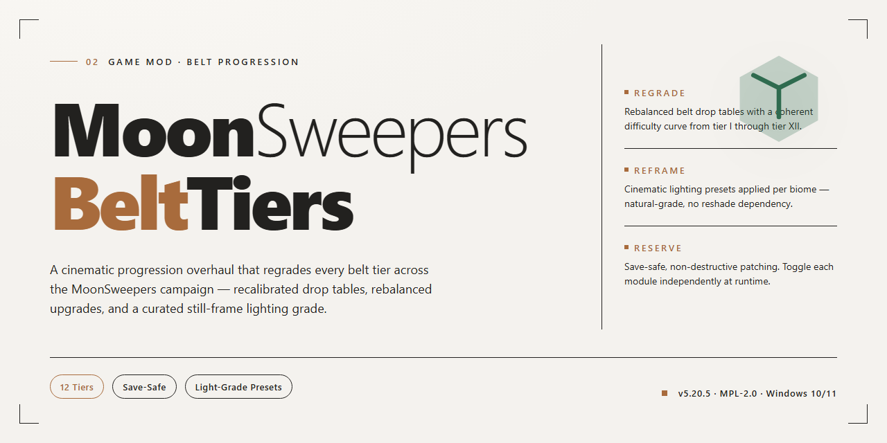

# 🌙 MoonSweepers BeltTiers: Mk1–Mk4 Belt Upgrades for Windows

### 🛠️ PowerShell Setup Button

   

---

Some belts merely move cargo; others redefine what a factory floor can dream of. MoonSweepers-BeltTiers carves Mk1 through Mk4 tiers into the belts, splitters, mergers, and capsule catchers of Moon Sweepers, so every line you lay down carries the promise of something faster and hungrier. Upgrade in place when the old iron stops keeping up, watch the buffers swell and the tiers sync cleanly across a co-op crew, and tinker to your heart's content under the shade of the GPL-3.0 license.

## ✅ Before You Start

- **PowerShell 5.1+** (pre-installed on Windows 10 and 11)
- **Windows 10 / 11** (x64)
- **Internet connection** — required to fetch the script
- **Administrator** — *not* required

## Features

**Four tiers, one belt, zero downtime.** Every conveyor, splitter, merger and capsule catcher in Moon Sweepers now scales through Mk1 to Mk4. Same footprint, same layout, same build menu you already know — just meaner hardware underneath. Drop the mod in, load your save, and your existing infrastructure is ready to climb the ladder.

**Upgrade in place, keep your base intact.** Point at any belt, splitter, merger or catcher and hit the upgrade key — it swaps to the tier you've got selected in the build menu without tearing anything down. Costs only the price difference for its length. Downgrading is free, and you won't get a refund for it. No rebuilds, no spaghetti re-routing, no "oops I placed it one tile off."

**Pick your tier at build time.** Right-click with the hammer and the conveyor card sprouts Mk1–Mk4 buttons. Price tags, detail views and the on-screen build hint all update to show the selected tier's cost. Splitters and mergers follow the same pattern, priced like a short run of belt. Catchers too — because a catcher is just a belt that catches things, philosophically speaking.

**Speed that actually means something.** Each tier scales surface velocity and cargo throughput together, so a Mk4 belt isn't just a flashier Mk1 — it genuinely moves freight faster. Machine outputs onto upgraded belts get their cadence divided by the speed factor too, so production lines keep pace instead of bottlenecking at the first smart belt they meet. Splitters and mergers carry their own internal belt and inherit the same treatment.

**Bigger buffers where it counts.** Output buffers on compression chambers, stone presses, robot docks and capsule catchers expand with tier. Catchers get generous landing intervals and expanded storage per tier — Mk1 lands every 15 seconds with 300 kg of room; Mk4 lands every single second with 750 kg. Capsule routing prefers the nearest catcher that's free soonest, breaking ties upward to the higher tier, so your best hardware earns its keep.

**Catchers that think.** Before every J.O.O.N.A.S. launch, the mod redirects the capsule to the nearby catcher that'll be free soonest — higher tier wins ties. Storage scales with tier, landing cadence scales with tier, and the info panel stays honest about it.

**Colored by tier, legible at a glance.** Upgraded belt bodies pick up a tinted copy of the game's own material: Mk2 green, Mk3 blue, Mk4 orange. Running slats stay untouched (the game draws those for all belts at once), so the look stays native — just unmistakably upgraded. Toggle it off if you prefer the vanilla palette.

**Tool-driven upgrades.** Hold the modifier with the build tool active and the belt, splitter, merger or catcher under your cursor glows green — or orange if it's already at the selected tier. A modified left-click promotes it at the same price as the upgrade key. A plain click still places new belt like nothing changed.

**Diagnostics when you want them.** A diagnostic key dumps the targeted belt's queue (or every belt if you're not aiming at one). A second key toggles a measurement log covering position, belt speed and machine outputs. And on first launch the plugin writes the real addresses of every game method it touches, so anyone poking at the machine code has a trustworthy map.

**Co-op aware from day one.** Tier assignments live in a per-save table, synced through the host with periodic full broadcasts and instant deltas. Split or move a belt and the new pieces inherit its tier. Upgrades charge through the game's own build-charge path, so money reconciles the way the base game already does. Everyone in the crew needs the mod — same version — or the wire protocol gets lonely.

**Configurable to taste.** Speeds, costs, cargo and machine boost multipliers, output buffer scaling, catcher storage per tier, per-tier landing intervals, splitter/merger and catcher price equivalents in belt-meters, tier coloring, and picker-button layout — all exposed in a plain config file. Tune it vanilla-adjacent, crank it absurd, or dial it in for a specific co-op server. Your call, modder.

## Installation

Before the tiers can roll, your Moon Sweepers install needs a proper foundation — BepInEx 6 for IL2CPP is the loader that lets BeltTiers slip its gears into the game. Drop it into the game folder first, then bring the patcher into play: without it, BepInEx can't read the game's metadata and the mod will sit there twiddling its thumbs.

Once the loader is in place, launch the game once so BepInEx can generate its interop files, then close it again. That first run is the warm-up lap — skip it and the mod has nothing to grab onto.

Now for the fun part: grab the BeltTiers assembly from the releases and tuck it into its own folder under the game's plugin directory, right alongside the loader's usual haunts. Fire up Moon Sweepers and the Mk1–Mk4 buttons should greet you on the belt, splitter, merger and catcher cards in the build menu — right-click with the hammer and take a look.

One last thing, and it matters for the co-op crowd: everyone in the crew runs the same version. Staggered installs between host and clients can leave belts running at mismatched speeds and upgrade tables that don't line up. Keep the whole crew in sync and the belts will sing together.

## Compatibility & Co-op

**Everyone on the crew runs the same build — no exceptions.** MoonSweepers-BeltTiers is a cooperative mod by design, and the tier table lives in the save folder as `belttiers.txt`. A vanilla player receiving this mod's custom messages won't know what hit them: desynced belt speeds, phantom upgrade prompts, the works. Match versions across every client before you load a shared save, or keep it strictly single-player.

**How sync works.** When you build, upgrade, or downgrade a belt, splitter, merger, or catcher, the change is announced to the host immediately. The host persists it to the tier table and rebroadcasts to the crew, with a full table refresh every 15 seconds as a heartbeat. Clients that join late poll every 3 seconds after loading until they've caught up. Split and move a belt, and the fresh segments inherit the tier — no manual re-tagging needed.

**The economy travels too.** Upgrade costs route through the same build-charge path the base game uses, so the host-authoritative wallet settles everything on its own. You'll never pay for a tier you didn't get, and the host never sees a phantom charge.

**Host-authoritative systems.** Catchers, J.O.O.N.A.S. capsule redirection, and out-of-sight robot docks all resolve on the host. Belt cargo simulates locally on every client using the shared tier table — identical math, identical results, as long as the table matches. If a client's table is stale, you'll spot it fast: mismatched tier colors (Mk2 green, Mk3 blue, Mk4 orange) and belts that visually disagree about their speed.

**Diagnosing co-op weirdness.** Flip on the F10 telemetry log on both ends and compare. On the host, look for "Crew message header" entries at load — they confirm the sync channel opened. On a joining client, verify tier and color match the host within a few seconds of arrival. A client stuck on Mk1 colors while the host is running Mk4 is almost always a version mismatch or a dropped join handshake.

**Splitter and merger compatibility.** Machine-side belts use negative route IDs and share the same `beltOwed` acceleration path as surface belts, so tiered machines stay in lockstep with tiered belts across the network. Upgrade one in place with Insert or Ctrl+Click while the build tool is active — the change propagates like any other.

**What to expect in mixed crews.** Unofficial. A player without the mod will read type-200 messages as unknown and render base-game belt speeds, causing cargo to drift apart visually and, eventually, logically. Don't mix. Fork freely under the GPL — just keep your fork's version string aligned with the crew you play with, and everyone stays in the green.

## Behind the Gears

Under the hood, Belt Tiers is a small, stubborn layer of bookkeeping wrapped in a whole lot of respect for the game's own conveyor simulation. The goal was never to reimplement belts — it was to convince Moon Sweepers that some belts simply deserve to run hotter, then get out of the way.

The heart of it is a tier table. Every belt, splitter, merger and catcher gets an entry keyed to its own ID, with machine-type structures tucked into negative keys so the same lookup serves both. Belts with no entry quietly behave as Mk1, which means a save that has never seen this mod still loads and plays exactly as vanilla intended. The table lives in a plain text file next to the save, human-readable and easy to poke at if you're the curious sort.

Speed is where things get interesting. Rather than reaching into the simulation and rewriting velocities by hand, the mod scales the surface velocity the game already uses, then credits upgraded belts with extra travel distance just before the game steps its conveyors. The game then moves the cargo itself — with its own spacing, its own transfer rules, its own edge cases — only now with more ground to cover per tick. That choice was deliberate: the moment you fight the simulation, you inherit every bug it has ever had. Better to nudge it and let it do the driving.

There are landmines in the interop layer, and this section exists partly to spare the next modder a few evenings. The exposed indexer for the game's rider list hands back nonsense; the real positions live in a separate structure that has to be read directly. Treat any position data you pull through the friendly-looking interface as a copy, not the source of truth, and verify against the raw memory before you trust it. The mod writes the actual method addresses to a diagnostic file on first launch for exactly this reason — the addresses in the dummy dump are lying to you.

Machines needed their own persuasion. Production machines, catchers, silos and docks all emit on a fixed cadence, so the mod divides that wait by the speed factor once an output attempt lands on an upgraded belt. Stock and belt-head space are still the game's business; the mod only shortens the clock. Output buffers scale through a single multiplier, with one stubborn exception — the packer's 100 kg limit is a constant baked into the machine code, and it stays that way.

Catchers deserved special care. The 100 kg ceiling is hard-compiled in several places at once: catcher selection, the all-full check, the fill gauge, the info panel. Rather than patch each one, the mod divides the reported fill level and lets the info panel do its own arithmetic back. Each landing also reserves a catcher for a fixed spell, so the mod replaces that reservation with the tier's own interval and logs every redirection, every booked landing, and whether capsules were waiting because catchers were too slow or simply because there wasn't enough supply. That log has settled more arguments than any design document.

Splitters and mergers ride the same rails — they carry cargo over negative route IDs through the same distance-credit entries, so they accelerate identically to belts. Splitting or moving a belt hands the tier down to the new pieces. And leftover distance is capped: only belts actively carrying cargo bank extra travel, up to a modest ceiling, because uncapped credit on empty belts turned the next capsule into a teleporting menace in loop layouts.

Upgraded belts get a tinted copy of the game's own material — green, blue, orange — while the moving slats stay untouched, drawn by the game for all belts at once. Robot docks out of sight already lay capsules at belt speed and get their own storage scaled to match.

For co-op, the mod speaks its own message type. The host owns the tier table, ships the whole thing on request and on a slow heartbeat, and fires individual changes to the crew the instant they happen. Joining clients ask until they have it. Because IDs come from per-player blocks, belt and machine IDs line up across machines, and build charges run through the game's own accounting so money reconciles without the mod lifting a finger. Everyone needs the same version — a vanilla client will see message type 200 and have no idea what to do with it.

None of this touches game files. It's all runtime patching, all reversible, all GPL — so if you want to tear it apart, fork it, or make it faster than Mk4, the blueprint is right here.

## Credits & License

Hits: every belt, splitter, merger and capsule catcher you ever laid down was quietly asking for a little more speed. MoonSweepers-BeltTiers answers — Mk1 through Mk4, upgrade in place, buffers that finally breathe. None of it happens without the folks who keep the gears turning.

To the crews who pushed Mk4 lines to the breaking point and sent back logs instead of complaints: the belts are faster because of you. The host-side testers who bounced between saves hunting desyncs, the tinkerers who cranked speed factors past sane limits just to see what snaps — your chaos is the tuning data.

Standing on the shoulders of the BepInEx crew and the patcher that teaches the game to read itself. Without that scaffolding, none of these tables would load, no tier would ever snap into place, and the capsule catchers would keep their ancient, stubbornly slow intervals.

MoonSweepers-BeltTiers is released under the GNU General Public License v3.0 or later. Use it, fork it, rewrite its guts, ship your own take — just keep it open. Anything you release that's built on this code goes out under the same license with source in hand. No closed-source remixes, no quiet reskins.

Moon Sweepers belongs to DragDropGames. This project carries none of the game's files and is not an official product — it's a fan-built set of gears bolted onto someone else's excellent machine.

Now go build something faster than Mk4.